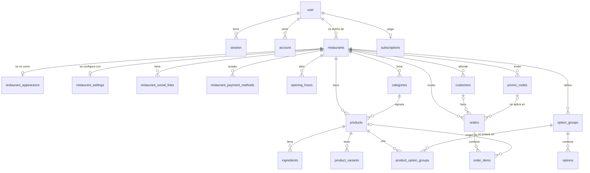

# Modelo de datos

Base: Cloudflare D1 (SQLite) con Drizzle ORM. Multi-tenant por `restaurant_id`.

Este documento es el **modelo objetivo** (22 tablas), diseñado en el editor vivo del modelo. Marca qué existe hoy y qué se propone, con la fase del plan en la que entra cada tabla. Reemplaza al modelo anterior.

Leyenda: **E** = existe en el código · **P** = propuesta · **F#** = fase del plan de implementación · `PK` clave primaria · `FK →` clave foránea · `?` admite NULL · `único` índice único.

## Relaciones



## Reglas de fondo

- **1 usuario, N restaurantes en la base; 1 en el código por ahora.** `restaurants.owner_id` **no** es único. Hoy el servicio permite un solo local por usuario, y un plan más caro subirá ese límite (`count(restaurants) < max_restaurants`). La regla vive en el servicio, no en una restricción de la base.
- **El plan es del usuario, no del restaurante.** La suscripción cuelga de `user`; cada restaurante hereda el plan de su dueño. `restaurants.plan` y `status` salen del modelo. El código actual (`plans.ts`, servicio de restaurantes) todavía los lee: quitarlos es una migración aparte.
- **Un restaurante, varias tablas 1:1 por tema.** `restaurants` guarda solo identidad. La apariencia, las reglas operativas, las redes y los métodos de pago viven en tablas propias.
- **Los pedidos guardan una foto (snapshot)** del cliente y de cada ítem (nombre, precio unitario, opciones). Editar el menú después no cambia el historial.
- **Importes en centavos de ARS** (`*_cents`, enteros). Sin punto flotante.
- **Claves de texto** (`id` text). Fechas como `timestamp_ms` (entero).

## Auth (Better Auth) · E

Tablas del núcleo de Better Auth. No se tocan.

```
user          PK id · name · email (único) · email_verified · image? · created_at · updated_at
session       PK id · expires_at · token (único) · created_at · updated_at · ip_address? · user_agent?
              · user_id FK → user.id
account       PK id · account_id · provider_id · user_id FK → user.id · access_token? · refresh_token?
              · id_token? · access_token_expires_at? · refresh_token_expires_at? · scope? · password?
              · created_at · updated_at
verification  PK id · identifier · value · expires_at · created_at · updated_at
```

## Restaurante

```
restaurants (E)                 PK id · owner_id FK → user.id · slug (único) · name · whatsapp
                                · delivery · takeaway · created_at · updated_at

restaurant_appearance (P, F0)   PK/FK restaurant_id → restaurants.id · logo_url? · cover_url?
                                · description · bg_color? · primary_color? · updated_at

restaurant_settings (P, F1)     PK/FK restaurant_id → restaurants.id · accepting_orders
                                · min_order_cents? · shipping_cents · updated_at

restaurant_payment_methods (P, F1)
                                PK (restaurant_id FK → restaurants.id, method) · enabled
                                · alias? · holder_name?

restaurant_social_links (P, F2) PK (restaurant_id FK → restaurants.id, network) · url

opening_hours (P, F2)           PK id · restaurant_id FK → restaurants.id · weekday · opens_at · closes_at
```

Notas:

- La apariencia ya vive en `restaurant_appearance` en el código (migración `0005_appearance`, sin commitear): crea la tabla, copia el logo de cada local existente y quita `logo_url` de `restaurants`. El local y su fila de apariencia se crean en el mismo batch de D1. `restaurants` todavía tiene `plan` y `status`; el plan pasará a `subscriptions` en una migración aparte.
- `delivery` y `takeaway` se quedan en `restaurants` para no tocar código que ya funciona. Se pueden pasar a `restaurant_settings` más adelante.
- `restaurant_appearance`: `logo_url` y `cover_url` guardan la ruta pública (la clave de R2 se deriva de ella). Los colores son `#RRGGBB` en mayúsculas; `NULL` significa "color por defecto". El logo está disponible en todos los planes; solo el color es Pro.
- `restaurant_settings`: una fila por restaurante, creada junto con el restaurante. `accepting_orders` pausa la tienda (por defecto activo). `min_order_cents` `NULL` es "sin mínimo". `shipping_cents` `0` es gratis y solo se suma en delivery. Los valores por defecto no deben cambiar el comportamiento de los locales existentes.
- `restaurant_payment_methods`: `method` es `cash` o `transfer` (más adelante, otros). `alias` y `holder_name` son columnas tipadas y quedan en `NULL` para métodos que no los necesitan (efectivo). El cliente los ve al pagar. **Regla de servicio:** si `method = transfer` y `enabled`, el `alias` es obligatorio. Un método nuevo con datos distintos requiere una columna nueva (migración); se acepta a cambio de validar.
- `restaurant_social_links`: `network` es un código corto (`instagram`, `facebook`, `tiktok`). Una red nueva no requiere migración.
- `opening_hours`: varias franjas por día. Una franja que cierra pasada la medianoche se guarda con `closes_at` menor que `opens_at`. El QR no necesita columna: se deriva del `slug`.

## Catálogo

```
categories (E)             PK id · restaurant_id FK → restaurants.id · name · position
                           · is_featured · created_at · updated_at

products (E)               PK id · restaurant_id FK → restaurants.id · category_id FK → categories.id
                           · name · description · price_cents · image_url? · available · position
                           · created_at · updated_at

ingredients (E, Pro)       PK id · product_id FK → products.id · name · included_qty · min_qty · max_qty
                           · extra_price_cents · position

product_variants (P, F2)   PK id · product_id FK → products.id · name · price_cents · available · position

option_groups (P, F2)      PK id · restaurant_id FK → restaurants.id · name · min_select · max_select · position

options (P, F2)            PK id · option_group_id FK → option_groups.id · name · extra_price_cents
                           · available · position

product_option_groups (P, F2)
                           PK (product_id FK → products.id, option_group_id FK → option_groups.id) · position
```

Notas:

- `categories`: el nombre es único por local sin distinguir mayúsculas (índice único sobre `(restaurant_id, lower(name))`; `lower()` de SQLite solo pasa a minúscula letras ASCII). Un índice único parcial sobre `(restaurant_id)` donde `is_featured = 1` impide dos categorías destacadas por local. Índice `(restaurant_id, position)`.
- `products`: `available = false` es "Agotado". Borrar una categoría con productos está bloqueado (`on delete restrict` y verificación del servicio). `position` empieza en 0, por local para categorías y por categoría para productos.
- `ingredients`: componentes del producto con cantidad incluida y precio por unidad extra (por ejemplo, queso: incluido 1, máximo 3, +$300 c/u). La lista se reemplaza completa en un solo batch. Se borra en cascada con el producto. Sin `restaurant_id` propio: el local se resuelve por el producto.
- **Add-ons** (`option_groups`, `options`, `product_option_groups`): un grupo es una pregunta al cliente ("Elegí tu salsa", mín 1 / máx 1; "Extras", mín 0 / máx 3). Las opciones son las respuestas. La tabla intermedia permite reutilizar un grupo en muchos productos y editarlo en un solo lugar. Los grupos cuelgan del restaurante, no del producto.
- `ingredients` y `options` se solapan en casos como "extra bacon". Hay que definir la frontera antes de construir la fase 2.
- `product_variants`: tamaños o presentaciones (Simple / Doble). Cuando un producto tiene variantes, `price_cents` del producto pasa a ser el precio "desde".

## Pedidos · P, F1

```
orders        PK id · restaurant_id FK → restaurants.id · customer_id? FK → customers.id · number
              · status · fulfillment · customer_name · customer_phone · delivery_address? · notes?
              · subtotal_cents · discount_cents · total_cents · promo_code_id? FK → promo_codes.id
              · created_at · updated_at

order_items   PK id · order_id FK → orders.id · product_id? FK → products.id · name · unit_price_cents
              · quantity · options_json? · notes?
```

Notas:

- `number` es una secuencia por restaurante. `fulfillment` es `delivery` o `takeaway`.
- `order_items` copia `name` y `unit_price_cents` al momento del pedido. `options_json` guarda la variante, los add-ons y los cambios de ingredientes elegidos. `product_id` pasa a `NULL` si se borra el producto.
- Los métodos de pago del pedido y el costo de envío cobrado todavía no tienen columna en `orders`: ver preguntas abiertas.

## Clientes y descuentos · P, F3

```
customers     PK id · restaurant_id FK → restaurants.id · name · phone · address? · notes?
              · first_order_at? · created_at · updated_at        (único: restaurant_id + phone)

promo_codes   PK id · restaurant_id FK → restaurants.id · code · kind · value · min_order_cents?
              · max_uses? · used_count · starts_at? · ends_at? · active · created_at
                                                                  (único: restaurant_id + lower(code))
```

## Planes · P, F5

```
subscriptions PK id · user_id FK → user.id (único) · plan · status · mp_preapproval_id?
              · trial_ends_at? · current_period_end? · created_at · updated_at
```

- La facturación pertenece al **usuario** (quien paga), no a un restaurante. Una suscripción por usuario.
- Los límites del plan (por ejemplo `max_restaurants`) viven en la definición del plan (`packages/shared/src/plans.ts`) y los verifica el servicio.
- Duración de la prueba y límites del plan gratis: se deciden al lanzar.

## Fases

| Fase | Tablas |
| --- | --- |
| Existen | `user`, `session`, `account`, `verification`, `restaurants`, `categories`, `products`, `ingredients` |
| F0 (cerrar lo abierto) | `restaurant_appearance` (mover los campos del cambio 10) |
| F1 (pedidos) | `orders`, `order_items`, `restaurant_settings`, `restaurant_payment_methods` |
| F2 (catálogo y tienda) | `product_variants`, `option_groups`, `options`, `product_option_groups`, `opening_hours`, `restaurant_social_links` |
| F3 (clientes y descuentos) | `customers`, `promo_codes` |
| F5 (cobro de planes) | `subscriptions` |

## Preguntas abiertas

- **Mercado Pago para el cliente final:** el análisis lo lista en el MVP, pero el plan solo lo usa para cobrar la suscripción. Hay que decidir cuál versión vale. De eso depende si `orders` necesita datos de pago.
- **`orders` sin método de pago ni envío cobrado:** falta decidir si se guardan `payment_method` y `shipping_cents` como foto en el pedido.
- **Zona horaria:** por restaurante o fija (America/Argentina), para `opening_hours` y la pausa.
- **`product_variants`:** cuando hay variantes, ¿`products.price_cents` se ignora o es la variante por defecto?
- **`customers`:** ¿se crean solos con el primer pedido o solo a pedido?
- **Baja de plan con varios locales:** ¿los locales extra quedan en solo lectura?
- **`ingredients` vs `options`:** frontera para casos como "extra bacon".
- **`delivery` y `takeaway`:** ¿pasan a `restaurant_settings`?

## Estado en el código y diferencias

- Existen las migraciones de `categories` y `products` (`0003_catalog`), `ingredients` (`0004_ingredients`) y apariencia (`0005_appearance`, sin commitear). Ver `docs/changes/04-menu-catalog.md`, `docs/changes/07-pro-features-ingredients.md` y `docs/changes/10-apariencia-del-local-y-menu-publico.md`.
- `whatsapp` se guarda normalizado (`549` + característica + número).
- `hours_json` nunca llegó a existir; lo reemplaza `opening_hours`.
- El campo `colors` previsto originalmente se reemplazó por dos columnas planas (`bg_color`, `primary_color`); el resto de la paleta se deriva en `packages/shared` (`themeFromColors`).
- El modelo anterior preveía `payments` y `order_events`. Se descartan: `orders` y `order_items` cubren las estadísticas, y el cobro de planes entra con `subscriptions` en la fase 5.
- Límites del plan: solo en `packages/shared/src/plans.ts`. Básico: hasta 40 productos y fotos incluidas; Pro: productos ilimitados. `customIngredients` y `customColors` son Pro. Portada, descripción y categoría destacada no tienen límite de plan.
- El menú público no lee estas tablas: lee el JSON publicado en KV (ver [Arquitectura general](Arquitectura-general.md)).

Related: [Arquitectura general](Arquitectura-general.md) · [Pagos y suscripciones](Pagos-y-suscripciones.md) · [Login y autenticación](Login-y-autenticacion.md) · [Personalización de ingredientes](Personalizacion-de-ingredientes.md) · [Storage e imágenes](Storage-e-imagenes.md)
